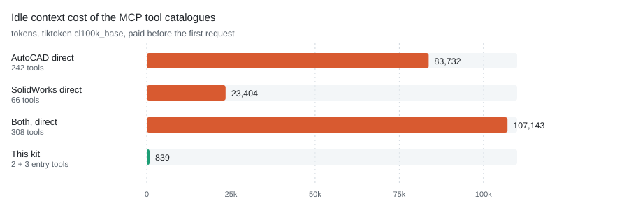

# dsh-sw-cad

[](LICENSE)
[](https://www.npmjs.com/package/dsh-sw-cad)
[](https://github.com/awesome-dsh-plugin/awesome-dsh-plugin)

**Two MCP servers and two skills that let a DeepSeek Harness or Codex agent drive real CAD software.**
They wire up two existing open-source projects — [U-C4N/Autocad-MCP](https://github.com/U-C4N/Autocad-MCP)
and [wzyn20051216/solidworks-automation-skill](https://github.com/wzyn20051216/solidworks-automation-skill) —
so an agent can draw in AutoCAD, model in SolidWorks, and export the results. This repository is the
configuration layer: isolated environments, launch parameters, on-demand loading and client registration.
It does not fork, patch or repackage either server. Both now hide their catalogs behind their own
discovery mode, so this repository no longer ships one: it configures theirs.

English | [中文](README.zh.md)

## What it does, and when you want it

A CLI agent that can read a drawing is useful. One that can *produce* one is a different tool. With this
kit installed, dsh or Codex can take a sentence like "draw an M6 threaded-hole bracket on an ISO A3 sheet
and export PDF" and actually do it — create layers, draw geometry, dimension it, stamp a title block,
run a validator, and hand back a file.

The catch is the same as every COM automation: **the CAD application must be running, and the agent must
run as the same Windows user and integrity level as the CAD app.** This is not a cloud service and there
is no headless substitute for native `.dwg` / `.sldprt` output.

Two skills are the entry points. They load lazily — the SKILL.md is read only when a request matches its
description, so an idle session pays nothing for them:

| Skill | How it works |
|---|---|
| `solidworks-automation` | Script-driven: 66 Python modules (30 `sw_*.py` COM wrappers plus OCCT/FEA/DFM tooling), with preflight, capability gating and evidence chains |
| `autocad-mcp-pro` | Authored here (upstream ships no AutoCAD skill). Drives the AutoCAD MCP through its two meta-tools |

Two MCP servers are the muscle, registered in the client config:

| Server | Tools advertised | Idle cost | Mode |
|---|---:|---:|---|
| `autocad` | 2 | 365 tokens | Upstream `DISCOVERY_MODE=search`: only `search_tools` + `call_tool`; the 242-tool catalog is searched by keyword |
| `solidworks` | 3 | 474 tokens | Upstream `SW_MCP_DISCOVERY=search`: `sw_search_tools`, `sw_describe_tool`, `sw_call_tool`; the 66-tool catalog (50 `solidworks_*` + 14 `cadstudio_*` + 2 `design_*`) is searched on demand, and would otherwise cost 23,411 |

<picture>
  <source media="(prefers-color-scheme: dark)" srcset="docs/token-cost-dark.svg">
  
</picture>

*Tool schemas are paid for before the first request. Connected directly the two servers cost 107,143
tokens; through this kit they cost 839, a 99.2% cut. Both sides are measured the same way: the
`tools/list` bytes on the wire, counted with `cl100k_base`.*

```
you speak natural language
   │
   ├─ dsh / Codex lazily loads a skill by its SKILL.md description
   │      ├─ solidworks-automation  → sw_*.py scripts → COM → SolidWorks
   │      └─ autocad-mcp-pro        → search_tools / call_tool → MCP → AutoCAD
   │
   └─ MCP servers (cordis.patch.yml / codex config.toml)
          ├─ autocad    upstream discovery mode, 242 tools on demand
          └─ solidworks upstream discovery, 3 entry tools, 66 tools on demand
```

## What is upstream, what is ours

This matters more than usual here, because the two servers are other people's work. The split is:

| Part | Origin | License |
|---|---|---|
| AutoCAD MCP server (`autocad-mcp-pro`) | [U-C4N/Autocad-MCP](https://github.com/U-C4N/Autocad-MCP), installed from PyPI | MIT |
| SolidWorks skill + MCP server | [wzyn20051216/solidworks-automation-skill](https://github.com/wzyn20051216/solidworks-automation-skill), cloned at install time | MIT |
| `skills/autocad-mcp-pro/SKILL.md` | Authored here — upstream has no AutoCAD skill | MIT |
| `bin/`, `lib/` (including `probe.py`, which checks for the CAD COM servers), `package.json`, `cordis.patch.yml`, `install.ps1`, `bootstrap.ps1`, `codex-config.snippet.toml`, `assets/`, READMEs | Authored here | MIT |

**Nothing upstream is vendored.** The installer fetches the PyPI package and clones (or zip-downloads) the
SolidWorks repository at install time, so you always get upstream's current code and upstream keeps
ownership of it. The value this repository adds is the part that was missing: verified launch parameters,
the discovery-mode configuration for both servers, the on-demand skill wiring, the junction trick that
keeps gigabytes off C:, and an installer that survives a blocked git
protocol.

## Install

Three ways in. Pick one, then check the prerequisites at the end of this section.

### 1. As a dsh plugin (recommended)

```bash
dsh plugin --profile web add dsh-sw-cad
```

That is the whole install. `package.json` declares `dsh.bundle.patch`, so dsh picks up this
repository's `cordis.patch.yml`, which inserts one row: this package. The package is a real cordis
plugin (`lib/index.js`), not a wrapper around a binary, so dsh imports it from the profile and
nothing has to be on PATH.

On first load the plugin resolves its own paths, installs the pinned upstream servers if they are
missing (a few minutes, once), and then registers the two MCP clients with absolute paths. If the
install cannot succeed it throws with the failing path and the command to re-run, instead of
registering rows that would fail silently. `SW_CAD_NO_AUTO_INSTALL=1` turns the automatic install off
and surfaces the missing pieces as an error instead.

### 2. npm, global (adds the CLI)

```bash
npm install -g dsh-sw-cad
dsh-sw-cad install
```

Same result, plus `dsh-sw-cad` on PATH for `doctor`, `where` and `serve` — useful when you want to
check the install without booting dsh.

### 3. Without npm: `bootstrap.ps1`

```powershell
git clone https://github.com/27painter/dsh-sw-cad.git
cd dsh-sw-cad
.\bootstrap.ps1 -Check     # report only, changes nothing; exits 1 if something is missing
.\bootstrap.ps1            # install whatever is missing
```

It inspects ten things and repairs only what is absent or stale:

| Check | Fixed by |
|---|---|
| Python ≥ 3.11 | nothing — it reports the problem and stops |
| `venv-autocad` + `autocad-mcp-pro` | `install.ps1` |
| `venv-solidworks` + `mcp` / `pymupdf` / `ezdxf` / `pywin32` | `install.ps1` |
| SolidWorks skill clone | `install.ps1` |
| `~/.dsh/skills` junction | created |
| `~/.dsh/cordis.patch.yml` entries | `install.ps1` (backs the file up first) |
| `~/.codex/skills` junctions | created |
| `~/.codex/config.toml` entries | appended, with a backup |

Running it twice is a no-op. It exits `0` when everything is in place and `1` otherwise, so it is safe to
wrap in a script or hand to an agent. Nothing is downloaded unless a core piece is actually missing.

> [!WARNING]
> Route 3 also writes `~/.dsh/cordis.patch.yml`. If you installed the plugin as well, that is a second
> registration of the same two servers under the same `serverName`, and dsh refuses the duplicate — the
> session fails to start. Use one route or the other, not both: with the plugin installed, keep
> `~/.dsh/cordis.patch.yml` at `[]`.

### Commands

| Command | What it does |
|---|---|
| `dsh-sw-cad install` | install the pinned upstream servers and write `~/.dsh/sw-cad.json` |
| `dsh-sw-cad doctor` | report present/missing pieces and the pinned versions, change nothing, exit 1 if something is missing |
| `dsh-sw-cad where` | print every path the servers will use |
| `dsh-sw-cad serve autocad\|solidworks` | run one MCP server over stdio, for manual testing |

`install` is idempotent, and the plugin runs it for you on first load. Versions are pinned in
`lib/upstream.json` — `autocad-mcp-pro` 1.6.0 and one SolidWorks skill commit — so a machine that
installs today and one that installs next month get the same servers.

> [!TIP]
> **Rather not run any of this yourself?** Paste the block below into dsh, Codex, or any agent that can
> run commands on this machine. It carries everything the agent needs, so you can read the rest of this
> section only if something goes wrong.

```text
Install https://github.com/27painter/dsh-sw-cad on this Windows machine.

Run: npm install -g dsh-sw-cad && dsh-sw-cad install
That installs the package, then the two upstream servers (AutoCAD MCP and the
SolidWorks skill) plus the client entries. dsh-sw-cad install is idempotent and
only touches what is missing.

Do not run it elevated: it must run as the same Windows user as AutoCAD and
SolidWorks. It writes nothing on C: except ~/.dsh and ~/.codex, and never touches
the CAD installations or the registry.
Then verify with: dsh-sw-cad doctor, dsh --profile headless --dump-config, codex mcp list.
Report any step that fails instead of silently working around it.
```

### Prerequisites

- Windows 10/11 with AutoCAD and/or SolidWorks installed
- Python ≥ 3.11 on PATH (`python --version`)
- dsh (DeepSeek Harness) or Codex CLI; Node ≥ 20 for routes 1 and 2
- Git — optional; the installer falls back to a codeload zip when git is blocked

### What if the CAD applications are not installed

The plugin checks for both COM servers before registering anything (`lib/probe.py`, a registry
ProgID lookup — it does not launch either application). A machine with only AutoCAD registers only
the AutoCAD server, and vice versa; a machine with neither registers nothing and says so in the log
instead of offering tools that could only fail.

```
[dsh-sw-cad] solidworks: no COM server registered on this machine, not registering it
[dsh-sw-cad] registered autocad (base D://cad-agents, upstream pinned in lib/upstream.json)
```

`SW_CAD_DISABLE=autocad,solidworks` turns that decision into a setting, and
`dsh-sw-cad doctor` prints what the probe found without starting dsh.

Note that *installed* is not the same as *running*. AutoCAD registered but closed means the AutoCAD
tools wait for the application and then fail with a message about a modal dialog; SolidWorks' own
health check reports the install, not the running instance. Starting the CAD application as the same
Windows user as your agent is the last step of any install.


### Version support

Upstream verifies against a single release but writes for a range. The honest picture:

| CAD | Verified | Expected to work | Why |
|---|---|---|---|
| AutoCAD | 2026 (every COM path, live run), 2027 (API compatible) | 2025 / 2024 / 2023 | COM goes through the long-stable ActiveX API. Run the upstream `scripts\smoke_*_com.py` against your build to confirm. And if COM cannot do something on your version, the ezdxf backend still can — it needs no AutoCAD at all. |
| SolidWorks | 2026 SP4.1 (upstream's acceptance target) | 2025 / 2024 / 2023 | The code carries explicit SW2024 fixes (Chinese edition: selecting a sketch by name, `AddComponent4` returning `None`), and upstream's contributor guide asks for 2020–2025 compatibility. 2023 has not been exercised. |

Older versions are not refused — nothing checks a version number. They are simply outside what upstream
verified, so start with one small job and look at the result before trusting a full drawing.

### Appendix — upstream's own install steps

These are the upstream projects' own instructions. This is also what `install.ps1` automates, so read it if
you want to understand or debug the install.

**AutoCAD MCP server** — [upstream install](https://github.com/U-C4N/Autocad-MCP#install). Into a venv on
the data drive (recommended here):

```powershell
python -m venv D:\cad-agents\venv-autocad
D:\cad-agents\venv-autocad\Scripts\python.exe -m pip install "autocad-mcp-pro[full]"
D:\cad-agents\venv-autocad\Scripts\autocad-mcp.exe --help    # stdio server entry point
```

Upstream's own one-liners, if you do not want a venv:

```bash
pip install autocad-mcp-pro              # or: uvx autocad-mcp-pro
autocad-mcp                              # backend auto-selected
AUTOCAD_MCP_BACKEND=ezdxf autocad-mcp    # headless DXF, no AutoCAD needed
AUTOCAD_MCP_BACKEND=com   autocad-mcp    # live AutoCAD (needs the [com] extra)
```

Extras: `[com]` = live AutoCAD control (pywin32 + Pillow), `[pdf]` = matplotlib for PDF/PNG output,
`[office]` = openpyxl for XLSX takeoffs, `[full]` = all of them. Upstream also documents an HTTP transport
(`autocad-mcp --transport http --port 8000`) and a JSON config for Claude Desktop / Cursor.

**SolidWorks skill + MCP** — [upstream quick start](https://github.com/wzyn20051216/solidworks-automation-skill#quick-start).
Upstream offers three entry points; pick one:

```bash
# Option 1 — skill only (simplest)
npx github:wzyn20051216/solidworks-automation-skill

# Option 2 — MCP via Smithery
npm install -g @smithery/cli
smithery mcp add wzyn20051216/solidworks-automation-skill --client codex --config '{}'

# Option 3 — CAD Studio desktop app, from the upstream Releases page
```

Manual clone (what this kit does, and what you need if you want the skill on the data drive):

```powershell
git clone --depth 1 https://github.com/wzyn20051216/solidworks-automation-skill.git D:\cad-agents\dsh-skills\solidworks-automation
D:\cad-agents\venv-solidworks\Scripts\python.exe -m pip install -r D:\cad-agents\dsh-skills\solidworks-automation\requirements.txt
D:\cad-agents\venv-solidworks\Scripts\python.exe -m pip install -r D:\cad-agents\dsh-skills\solidworks-automation\mcp-server\requirements.txt
D:\cad-agents\venv-solidworks\Scripts\python.exe D:\cad-agents\dsh-skills\solidworks-automation\scripts\cad_doctor.py
```

**Set `SW_MCP_DISCOVERY=search` on the SolidWorks server** (every route above does this for you; this is
the manual step). Upstream defaults to it since 2026-10-29, so an unconfigured client already gets the
three entry tools; setting it explicitly keeps that true if upstream ever changes the default back.
Without it the client carries all 66 tool schemas — 23,411 tokens — in every request.

**Register both servers with your client.** dsh reads `~/.dsh/cordis.patch.yml` — copy this repository's
`cordis.patch.yml` there. It inserts one row — this package — and the plugin registers the servers itself,
so nothing has to be on PATH. Codex reads
`~/.codex/config.toml` — append `codex-config.snippet.toml`, or use upstream's own registrar
(`mcp-server\register_codex_mcp.ps1 -Python <venv python> -InstallDependencies`). The Codex snippet does
contain absolute paths, so adjust those to your `-BaseDir`.

**Make the skills visible.** Both clients only scan their own skills directory:

```powershell
# dsh: one junction for the whole skills folder (matches what install.ps1 does)
New-Item -ItemType Directory -Force -Path "$env:USERPROFILE\.dsh" | Out-Null
New-Item -ItemType Junction -Path "$env:USERPROFILE\.dsh\skills" -Target "D:\cad-agents\dsh-skills"

# Codex: one junction per skill (its skills folder may hold other skills)
New-Item -ItemType Directory -Force -Path "$env:USERPROFILE\.codex\skills" | Out-Null
New-Item -ItemType Junction -Path "$env:USERPROFILE\.codex\skills\solidworks-automation" -Target "D:\cad-agents\dsh-skills\solidworks-automation"
New-Item -ItemType Junction -Path "$env:USERPROFILE\.codex\skills\autocad-mcp-pro"       -Target "D:\cad-agents\dsh-skills\autocad-mcp-pro"
```

### Appendix — what `install.ps1` does

`install.ps1` runs everything in the appendix above, plus the parts that are easy to get wrong: both venvs on the data
drive, the junctions, the discovery-mode parameters, and a timestamped backup of `~/.dsh/cordis.patch.yml`.

```powershell
powershell -ExecutionPolicy Bypass -File .\install.ps1

# custom locations / force rebuild
.\install.ps1 -BaseDir "E:\cad" -WorkDir "E:\AutoCad" -Force
```

It checks Python, creates the directories, builds the venvs, installs `autocad-mcp-pro[full]` and the
SolidWorks requirements, fetches the skill at the pinned commit (zip, so git is not needed), junctions the
skills into `~/.dsh/skills`, writes the dsh config, and drops the AutoCAD skill in place.

If you are not sure what is already on the machine, run `bootstrap.ps1` instead: it decides whether
`install.ps1` is needed at all.

**Codex users still need one step** — append `codex-config.snippet.toml` to `~/.codex/config.toml` and
junction the two skills into `~/.codex/skills/` (last four commands of the appendix above).

> [!IMPORTANT]
> **Start AutoCAD / SolidWorks first, as the same user.** COM automation crosses a process boundary that
> Windows guards by user and integrity level. An agent started elevated while the CAD app runs normally
> (or vice versa) will connect to nothing, and the failure looks like "the tool did nothing".

## Usage

Just describe the drawing. The skill loads itself.

```text
Open AutoCAD, draw a bearing housing: base 120×80×10, upright 60 high × 12 thick,
φ40 through hole on top. ISO A3 sheet with title block and dimensions, save to
D:\AutoCad and export PDF.
```

```text
In SolidWorks, build a flange: OD 100, 20 thick, 30 bore, four M10 bolt holes on a
bolt circle. Save as SLDPRT and export STEP.
```

Practical notes, learned the hard way:

- **SolidWorks tools nest their arguments.** The upstream tools take their payload under a `params` key,
  so a call looks like `call_tool(name="solidworks_sketch_and_extrude", arguments={"params": {"shape":
  "rectangle", "width_mm": 60, "height_mm": 40, "depth_mm": 10}})`. AutoCAD tools take theirs flat.
  Getting this wrong fails with a pydantic message about a missing `params` field, which is the hint.
- **Say one CAD at a time.** Mentioning both loads both skills and mixes the task.
- **Ask for a plan first on anything complex.** Both skills have a planning step; approving a plan before
  geometry is drawn is cheaper than undoing a bad drawing.
- **Ask for the preview.** The AutoCAD path ends in an 8-step validator plus a screenshot; the SolidWorks
  path exports four orthographic previews. "Show me the preview" is a fair request and the skills honor it.
  One caveat, measured here: the AutoCAD screenshot needs the window to be visible — with AutoCAD hidden or
  minimised it comes back blank. The geometry itself is always verifiable through the API (handles, bounding
  boxes, mass properties), so do not treat a blank image as a failed drawing.

## Verification

```powershell
# everything present? read-only, exits 1 if something is missing
dsh-sw-cad doctor

# every path the servers will use
dsh-sw-cad where

# dsh sees both servers and both skills
pnpm dsh --profile headless --dump-config
pnpm dsh --profile headless "list available skills"

# SolidWorks skill self-check (Python deps + COM)
& "D:\cad-agents\venv-solidworks\Scripts\python.exe" "D:\cad-agents\dsh-skills\solidworks-automation\scripts\sw_preflight.py"

# both MCP servers answer a handshake through the same entry point dsh uses
node bin\dsh-sw-cad.mjs serve solidworks     # expects solidworks_mcp, 3 entry tools
node bin\dsh-sw-cad.mjs serve autocad        # expects AutoCAD MCP Pro, 2 entry tools

# Codex
codex mcp list
```

What was verified before publishing, against live applications (AutoCAD 2026 and SolidWorks 2026
running): `system_status` returns `connected: true`, `backend: com`, the running version and the active
document name; `drawing_info` returns the open document's entity count, extents and units; `layer_list`
returns the live layer table; and the SolidWorks side reports `status: ok` with the running instance
detected. Both `serve` targets also answer a JSON-RPC handshake through the package's own binary — the
AutoCAD server reports `AutoCAD MCP Pro 3.4.11` (the pip package is 1.6.0, the server carries its own
version), the SolidWorks server reports `solidworks_mcp` 1.30.0 — and they advertise 2 and 3 entry tools.
Discovery finds `gear_draw_spur_front_view` / `keyway_draw_keyed_bore` by keyword; on the SolidWorks side
`sw_search_tools` with the Chinese query "健康检查" returns `solidworks_health_check`, and `sw_call_tool`
runs it against a live SolidWorks 2026. `dsh --dump-config` loads both rows from this package; the
SolidWorks preflight passes.

## Design notes

**1. Discovery mode is the whole trick.** 242 tool schemas cost 83,732 tokens if advertised. In discovery
mode the client sees two tools (365 tokens) and searches a catalog that carries 206 AutoCAD command names
plus 1439 synonyms — say "chamfer" and it finds `FILLET`.

**2. SolidWorks used to need a shim; upstream built one instead.** Until 2026-10-29 that server registered
all 66 tools unconditionally — 23,411 tokens before the first request — so this repository carried a shim
that advertised two meta-tools in front of it. Upstream then implemented the same idea itself, better
tested, and this bundle switched to it: `SW_MCP_DISCOVERY=search` exposes `sw_search_tools`,
`sw_describe_tool` and `sw_call_tool` (474 tokens) with bilingual synonym scoring, and `sw_describe_tool`
returns a single schema on demand, which the shim never could. The shim was removed rather than kept as a
second implementation of a feature its owner now maintains.

**3. Keep `TOOL_PROFILE=full` and `TOOL_PACKS=all`.** They only narrow the *searchable* catalog and do not
change idle cost. Measured: `lean + core,mech` drops the catalog to 58 tools and makes the parametric gear
and keyway tools unfindable. Narrowing packs loses capability without saving a token.

**4. Junctions, not copies.** dsh only scans `~/.dsh/skills`, Codex only scans `~/.codex/skills`. Directory
junctions point both at the data drive; neither tool notices. Deleting a junction does not delete data.

**5. Scope the file access.** The AutoCAD server's `ALLOWED_PATHS` is empty by default, and its own README
says to set it. This kit sets it to a working directory.

**6. Know what is verified.** The version table under Install says it plainly: upstream verified AutoCAD
2026 and SolidWorks 2026 SP4.1. Everything else is expected, not proven — run one small job first.

**7. Discovery is not free, it is deferred.** Every tool call costs one extra round trip: search, then
call. For a single "draw a box" that is slower than calling the upstream tool directly. It is the right
trade when a session makes several calls, which is the normal case for CAD work.

**8. It ships as a plugin, not as a bin the patch calls.** The first version registered two MCP client
rows whose `command` was `dsh-sw-cad`, which only resolves when the package is installed globally — so
`dsh plugin add` on its own left two rows that could not start. A reviewer caught that, correctly.
`lib/index.js` now imports as a cordis plugin and registers the two clients itself with absolute
paths, which removes the PATH dependency and lets it check the upstream before registering anything.

**9. Pinned, because "latest" is not a version.** `lib/upstream.json` records the exact
`autocad-mcp-pro` release and the exact SolidWorks skill commit this bundle was validated against;
`install.ps1` uses them for both the pip install and the archive download. Bumping them is a deliberate
commit: re-check that `SW_MCP_DISCOVERY=search` still exposes the three entry tools before publishing.

## Troubleshooting

| Symptom | Cause / fix |
|---|---|
| dsh lists no skills | `~/.dsh/skills` must be a junction whose target exists; folder name must equal the frontmatter `name` |
| Codex lists no skills | both junctions under `~/.codex/skills\`; Codex must support skills |
| AutoCAD tools return nothing | CAD not running, or different user/integrity level; set `AUTOCAD_MCP_BACKEND=com` to rule out the ezdxf fallback |
| SolidWorks preflight fails | missing deps (`requirements.txt` of the skill) or SW not running |
| `sw_search_tools` returns nothing useful | the server is running in `full` mode, so there is no search entry — check `SW_MCP_DISCOVERY` |
| `sw_call_tool` says the tool is unknown | it rejects names not in the catalog; run `sw_search_tools` first to get the exact name |
| `codex mcp list` empty | the snippet must sit at the end of `config.toml`; paths need doubled backslashes |
| `git clone` fails during install | the installer falls back to a codeload zip automatically |

## License

MIT (see [LICENSE](LICENSE)). Upstream components remain under their own MIT licenses; this repository
redistributes neither.
