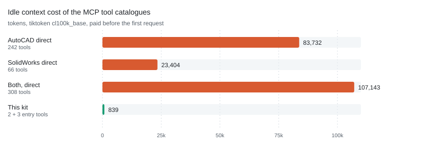

# dsh-sw-cad

[](LICENSE)
[](https://www.npmjs.com/package/dsh-sw-cad)
[](https://github.com/awesome-dsh-plugin/awesome-dsh-plugin)

English | [中文](README.zh.md)

> Other CAD MCP servers hand the agent tools. **This one hands it a delivery it can prove.**

A dsh / Codex plugin that lets an agent drive **AutoCAD and SolidWorks** for real: draw on an ISO sheet,
model a part, export STEP, and then **read the result back** and say whether it holds up. Two MCP servers,
two skills, and one command — `dsh-sw-cad deliver` — that turns "the agent says it finished" into a
verdict you can check. When the drawing has to be checked by someone else, a second profile also holds the
fits, material and surface finish to a table instead of trusting them.

```powershell
dsh-sw-cad deliver D:\work\part-001 --require drawing,pdf
# verdict: pass  (0 failure(s), 0 warning(s))  -> D:\work\part-001\delivery.json
```

## What is in here

| Part | What it is | Where it comes from |
|---|---|---|
| `autocad` MCP server | 242 tools behind a search entry, COM or headless ezdxf | upstream [U-C4N/Autocad-MCP](https://github.com/U-C4N/Autocad-MCP), from PyPI, pinned |
| `solidworks` MCP server | 66 tools behind a search entry, COM | upstream [wzyn20051216/solidworks-automation-skill](https://github.com/wzyn20051216/solidworks-automation-skill), cloned at install, pinned |
| `solidworks-automation` skill | 66 Python modules: `sw_*.py` COM wrappers, OCCT/FEA/DFM, GB/T drawing sub-skill | same upstream |
| `autocad-mcp-pro` skill | How to drive the AutoCAD MCP: layer discipline, ISO 7200 title block, real dimension entities, the delivery gate | **authored here** — upstream ships no AutoCAD skill |
| `dsh-sw-cad` CLI | install, doctor, where, serve, **deliver**, **mode** | **authored here** |
| Codex plugin shell | `.codex-plugin/plugin.json`, `.mcp.json`, two lazy skills, and a read-only `SessionStart` preflight | **authored here** |
| `lib/standards.json` | The value table half-delivery mode judges against: fits, material grades, heat and surface treatment, the Ra series | **authored here** |
| `patches/` | Two upstream defects fixed, offered upstream as PRs | **authored here** |

Nothing upstream is vendored. The installer fetches the PyPI package and clones the skill at a pinned
commit, so upstream keeps ownership of its code and you get its current release.

## Install

Four routes. Pick one.

**1. As a Codex plugin** — install it from the repository's marketplace:

```powershell
codex plugin marketplace add 27painter/dsh-sw-cad --ref main
codex plugin add dsh-sw-cad@dsh-sw-cad
```

Start a new Codex task and approve the `SessionStart` hook when Codex asks. The hook runs the read-only,
non-blocking `doctor --plugin --soft`; it does not install anything. The MCP entry starts on demand, and its packaged `serve` command
installs the pinned upstream the first time a CAD side is used. The 300-second startup timeout leaves room
for that first install.

The plugin ships its own manifest, MCP declaration, skills, hook, and icon. It runs
`node ./bin/dsh-sw-cad.mjs` from the installed plugin cache, so a global `dsh-sw-cad` command is not needed.

Codex cannot probe which CAD exists before registering plugin MCP rows. Both are declared. On a machine with
only one CAD, disable the other side in `~/.codex/config.toml`:

```toml
[plugins."dsh-sw-cad@dsh-sw-cad".mcp_servers.autocad]
enabled = false
```

Use the same block with `solidworks` when only AutoCAD is installed. The manual
`codex-config.snippet.toml` is for a non-plugin, npm-global setup; do not add it beside the plugin.

**2. As a dsh plugin** — the whole install is one line; `package.json` declares `dsh.bundle.patch`, so dsh
loads `cordis.patch.yml`, which inserts one row: this package. On first load the plugin resolves its paths,
installs the pinned upstream servers if they are missing, then registers both MCP clients with absolute
paths. If that cannot succeed it throws with the failing path instead of registering rows that fail silently.

```bash
dsh plugin --profile web add dsh-sw-cad
```

**3. npm, global** — same result, plus the CLI on PATH:

```bash
npm install -g dsh-sw-cad
dsh-sw-cad install
dsh-sw-cad doctor
```

**4. From a checkout** — no npm needed, and the only route that gives you `bootstrap.ps1 -Check`, which
inspects ten things and repairs only what is missing:

```powershell
git clone https://github.com/27painter/dsh-sw-cad.git
cd dsh-sw-cad
.\bootstrap.ps1 -Check     # report only, changes nothing, exits 1 if something is missing
.\bootstrap.ps1            # install whatever is missing
```

> [!WARNING]
> Route 4 also writes `~/.dsh/cordis.patch.yml`. With the dsh plugin installed that is a second registration
> of the same two servers under the same `serverName`, and dsh refuses the duplicate — the session fails to
> start. Use one route or the other; with the plugin, keep that file at `[]`.

**Prerequisites:** Windows 10/11 with AutoCAD and/or SolidWorks, Python ≥ 3.11, and dsh or Codex. Node ≥ 20
for the Codex plugin, dsh plugin, and npm routes. Git optional — the installer falls back to a codeload zip
when git is blocked.

The two upstream projects' own install instructions, kept verbatim for debugging a hand install, are in
[`docs/upstream-install.md`](docs/upstream-install.md).

**A machine with only one CAD** works in every route, with one difference. The dsh plugin checks the COM
registry before registering anything (`lib/probe.py`; it does not launch either application), so it registers
only the sides that can work. `SW_CAD_DISABLE=autocad` turns that decision into a setting. In the Codex
plugin both rows are static, so disable the unused server with the `config.toml` block above.

**A machine with neither CAD** does not fail the plugin load either: one log line says there is nothing to
drive, and no MCP row is registered. `deliver` only reads files and never starts a CAD application, so that
half still works. The probe runs before the install step, so an empty machine never installs the upstream
servers for nothing.

> [!IMPORTANT]
> **Start AutoCAD / SolidWorks first, as the same user.** COM crosses a process boundary that Windows
> guards by user and integrity level. An agent started elevated while the CAD app runs normally (or the
> reverse) connects to nothing, and it looks like "the tool did nothing".
>
> This rule is specific to COM. [`dsh-nx`](https://github.com/27painter/dsh-nx) drives NX through NXOpen
> inside the NX process, so an open NX window cannot be attached to and that plugin starts its own batch
> session instead. Do not carry the habit across.

## Using it

Describe the drawing; the skill loads itself.

```text
Open AutoCAD, draw a bearing housing: base 120×80×10, upright 60 high × 12 thick,
φ40 through hole on top. ISO A3 sheet with title block and dimensions, save to
D:\AutoCad and export PDF.
```

```text
In SolidWorks, build a flange: OD 100, 20 thick, 30 bore, four M10 bolt holes on a
bolt circle. Save as SLDPRT and export STEP.
```

Four things learned the hard way:

- **SolidWorks tools nest their arguments.** The payload goes under `params`:
  `call_tool(name="solidworks_sketch_and_extrude", arguments={"params": {"shape": "rectangle", ...}})`
  AutoCAD tools take theirs flat. The pydantic complaint about a missing `params` field is the hint.
- **Say one CAD at a time.** Naming both loads both skills and mixes the task.
- **Ask for a plan first on anything complex.** Both skills have a planning step, and approving a plan is
  cheaper than undoing a bad drawing.
- **Ask for the preview.** The AutoCAD path ends in an 8-step validator plus a screenshot; the SolidWorks
  path exports four orthographic views. One caveat measured here: the AutoCAD screenshot needs a visible
  window — hidden or minimised comes back blank, which is not a failed drawing. Geometry stays verifiable
  through the API either way.

## Delivery check

This is the part that is not in the upstream projects.

The two skills end differently. The AutoCAD side calls `drawing_finalize` — an eight-step validator that
raises instead of returning, so a model cannot claim success over a broken drawing. The SolidWorks side
asks for four previews and a review report, and trusts the model to look at them. `deliver` is the shared
ending: it starts no CAD, reads what landed on disk, and exits non-zero when it does not hold up.

```powershell
dsh-sw-cad deliver D:\work\part-001 --require drawing,pdf
dsh-sw-cad deliver D:\work\part-001 --out D:\work\delivery.json --json
```

| kind | what is actually read |
|---|---|
| `.dxf` | ezdxf: `DIMENSION` entities, layer table, `$INSUNITS`, whether a paper-space layout has anything on it, the plot sheet against ISO 216, whether 比例/SCALE is stated, line-weight levels, the font behind Chinese text, dimension texts that sit on top of each other, a title-block hint |
| `.dwg` | header only — the `AC1032`-style version tag; counting entities needs a converter |
| `.pdf` | PyMuPDF: page size against ISO 216, and whether the text layer is real |
| `.step` | `FILE_SCHEMA` resolved to AP203/214/242, entity and `CARTESIAN_POINT` counts, bounding box from the raw points — which catches a scaled part or an export with no geometry. AP203 warns: it drops colour and assembly structure |
| `.sldprt` / `.sldasm` | presence, size, file signature. Geometry is not checked — that needs the application |
| `*_review_report.json` | `evaluation.status == pass`, and no issues |

A failed run reads like this, which is the point:

```
drawing  empty.dxf  18470 B
  FAIL drawing.dimensions     0 DIMENSION entities in modelspace
  FAIL drawing.units          $INSUNITS=0 (unitless)
  FAIL drawing.sheets         no sheet has anything on it; nothing frames the drawing
step     old.step  1779 B
  warn step.pmi               AP203 drops colour and assembly structure; use AP214 or AP242
  FAIL step.entities          40 entities, 40 CARTESIAN_POINTs
report   part_review_report.json  101 B
  FAIL review.status          evaluation.status='fail'
verdict: fail  (5 failure(s), 1 warning(s))
```

Exit 0 means the delivery holds up, 1 means it does not. **An empty folder is a failure** — a job that
produced nothing must never report success. Every file gets a SHA-256 in `delivery.json`, so "this is the
version that was checked" is a fact rather than a filename.

Warnings never change the exit code and always carry their reason: AP203, an unreadable DWG, a native part
that was not opened, a missing Python dependency, a drawing with only one line weight.

**What it does not check, and will not pretend to:** tolerance and fit values (`H7/g6`), material, heat
treatment, surface finish, whether a dimension chain closes, whether the part can actually be machined.
The tools let a model type any of those, and there is no standard table here to compare against. `pass`
means the files hold up as files — not that the drawing is ready for the shop.

Rules per check, and the JSON shape: [`docs/delivery.md`](docs/delivery.md). The AutoCAD skill ships the
step as item 6 of its workflow; the SolidWorks skill is upstream text and is not modified here, so on that
route the check has to be invoked — in the task instruction, or as the last step of your script.

### Two profiles

`normal` (default) checks the files. `half` also requires the values written on the drawing to come from
`lib/standards.json`: fits (`H7/g6`), material grades (`45`, `40Cr`, `6061`), roughness in the preferred
series. A value outside the table fails, and so does a drawing with no material and no `Ra`.

```powershell
dsh-sw-cad mode half        # set once; every later deliver inherits it
dsh-sw-cad mode             # what is set now
dsh-sw-cad deliver D:\work\part-001 --profile half   # one-off override
```

The choice is made once per job, not per part — a batch of twenty drawings should not stop and ask twenty
times. The skill asks a single question at the start, and only when the request does not already say what
the drawing is for.

`delivery.json` records `"profile": "half"` together with what is still unchecked. **A half-delivery pass
is not full compliance**, and the report says so instead of letting the two be confused.

## What it costs in context

Tool schemas are paid for before the first request. Both servers hide their catalogs behind their own
discovery mode, so the client carries two entry tools per server instead of the whole catalog:

| Server | Entry tools | Idle cost | Catalog behind it |
|---|---:|---:|---|
| `autocad` | 2 (`search_tools`, `call_tool`) | 365 tokens | 242 tools, searched by keyword |
| `solidworks` | 3 (`sw_search_tools`, `sw_describe_tool`, `sw_call_tool`) | 474 tokens | 66 tools (50 `solidworks_*`, 14 `cadstudio_*`, 2 `design_*`) |

<picture>
  <source media="(prefers-color-scheme: dark)" srcset="docs/token-cost-dark.svg">
  
</picture>

Connected directly the two servers cost 107,143 tokens before the first request; through this kit, 839 —
a 99.2% cut. Both sides measured the same way: `tools/list` bytes on the wire, counted with `cl100k_base`.

```
you speak natural language
   │
   ├─ dsh / Codex loads a skill by its SKILL.md description
   │      ├─ solidworks-automation → sw_*.py → COM → SolidWorks
   │      └─ autocad-mcp-pro       → search_tools / call_tool → MCP → AutoCAD
   │
   └─ MCP servers (cordis.patch.yml / Codex plugin .mcp.json)
          ├─ autocad    upstream discovery, 2 entry tools
          └─ solidworks upstream discovery, 3 entry tools
```

## What has been verified, and what has not

| CAD | Verified | Expected | Why |
|---|---|---|---|
| AutoCAD | **2026** — every COM path, live run; 2027 API-compatible | 2025 / 2024 / 2023 | COM goes through the long-stable ActiveX API. Upstream ships `scripts\smoke_*_com.py` to confirm a build, and the ezdxf backend needs no AutoCAD at all. |
| SolidWorks | **2026 SP4.1** (upstream's acceptance target), **2025 SP05** live run: part → sketch → rectangle → extrude → one body → save → STEP | 2024 / 2023 | The code carries explicit SW2024 fixes (Chinese edition: selecting a sketch by name, `AddComponent4` returning `None`). The 2025 run produced a Chinese sketch name (`草图1`), so that path was exercised. 2023 has not been. |

Nothing refuses an older release — nothing checks a version number. They are simply outside what has been
run, so start with one small job and look at the result.

What this package itself has run, live: `system_status` returns `connected: true`, `backend: com`, the
running version and active document; `drawing_info` returns entity count, extents and units; `layer_list`
returns the live layer table; the SolidWorks side reports `status: ok` with the instance detected. Both
`serve` targets answer a JSON-RPC handshake through this package's own entry point — AutoCAD reports
`AutoCAD MCP Pro 3.4.11` with 2 entry tools, SolidWorks reports `solidworks_mcp` 1.30.0 with 3 — and
`sw_call_tool` with the Chinese query "健康检查" reaches `solidworks_health_check` against a live
SolidWorks 2026. `dsh --dump-config` loads both rows from this package.

The Codex plugin shell was installed from this repository's local marketplace into an isolated
`CODEX_HOME`. `codex plugin list` and `codex mcp list` resolved both rows to the plugin cache,
`SessionStart` completed with `doctor --plugin`, and `npm run test:serve` opened both packaged entries:
AutoCAD reported 2 tools, SolidWorks 3.

## When something goes wrong

| Symptom | What it usually is |
|---|---|
| Tools do nothing, no error | CAD not running, or running as a different user / integrity level than the agent |
| AutoCAD tools hang, then mention a modal dialog | A dialog is open in AutoCAD — a licence prompt, a save prompt, a recovery pane |
| `dsh` fails to start after installing two ways | Both a plugin row and a `~/.dsh/cordis.patch.yml` entry. Keep one |
| `dsh --dump-config` shows no rows | The bundle patch was not picked up: check `package.json` declares `dsh.bundle.patch` |
| Codex lists no skills | Run `codex plugin list`, confirm `dsh-sw-cad` is installed and enabled, then start a new task. Manual non-plugin installs use junctions under `~/.codex/skills\` |
| A Codex MCP row fails on a one-CAD machine | Disable the missing side under `[plugins."dsh-sw-cad@dsh-sw-cad".mcp_servers.<side>]` in `~/.codex/config.toml` |
| The first CAD request times out | The upstream install may still be running. Run `doctor`, then retry; MCP startup is allowed 300 seconds |
| The Codex `SessionStart` hook does not run | Plugin hooks require explicit trust. Review and trust it in Codex, then start a new task |
| AutoCAD screenshot is blank | The window is hidden or minimised. Geometry is still verifiable through the API |
| `sw_call_tool` rejects a name | It only accepts names from the catalog; run `sw_search_tools` first |
| `sw_search_tools` returns nothing useful | The server is in `full` mode, so there is no search entry — check `SW_MCP_DISCOVERY` |
| A dimension measures 0.0, or an edge length is null | The upstream patches are not applied: `python patches\apply_patches.py --check` |
| `deliver` fails on a drawing you believe is fine | Read the failing check id — each one names what it looked for and what it found |

## Verify an install

```powershell
dsh-sw-cad doctor                              # read-only, exit 1 when something is missing
dsh-sw-cad where                               # every path the servers will use
dsh --profile headless --dump-config           # dsh sees both rows
python patches\apply_patches.py --check        # read-only, exit 1 when a patch drifted
npm run test:serve                             # JSON-RPC handshake, expects 2 + 3 entry tools
npm test                                       # dsh wiring, Codex manifest, and 6 delivery cases
codex plugin list                              # Codex sees dsh-sw-cad@dsh-sw-cad
codex mcp list                                 # autocad and solidworks rows
codex mcp get autocad                          # resolved command, cwd, and timeouts
codex mcp get solidworks
```

## Provenance

| Part | Origin | License |
|---|---|---|
| AutoCAD MCP server | [U-C4N/Autocad-MCP](https://github.com/U-C4N/Autocad-MCP), from PyPI, pinned to 1.6.0 | MIT |
| SolidWorks skill + MCP server | [wzyn20051216/solidworks-automation-skill](https://github.com/wzyn20051216/solidworks-automation-skill), cloned at a pinned commit | MIT |
| AutoCAD skill, CLI, installer, `deliver`, `patches/`, this README | this repository | MIT |

**One deliberate exception to "we do not touch upstream":** `patches/` carries two fixes for upstream
defects that fail silently — a vertical linear dimension measures 0.0, and every edge's diameter and length
come back null. Both are open as pull requests upstream; until they land, `install.ps1` applies them to the
installed copies and `apply_patches.py --check` reports drift. See [`patches/README.md`](patches/README.md)
and [`THIRD-PARTY-NOTICES.md`](THIRD-PARTY-NOTICES.md).

## License

MIT, Copyright (c) 2026 27painter — see [LICENSE](LICENSE). Upstream components keep their own MIT licences;
this repository redistributes neither.

Listed on the [M8ven Trust Index](https://m8ven.ai/mcp/27painter-dsh-sw-cad-72nbze) and on
[awesome-dsh-plugin](https://github.com/awesome-dsh-plugin/awesome-dsh-plugin).

[](https://m8ven.ai/mcp/27painter-dsh-sw-cad-72nbze?s=readme)
