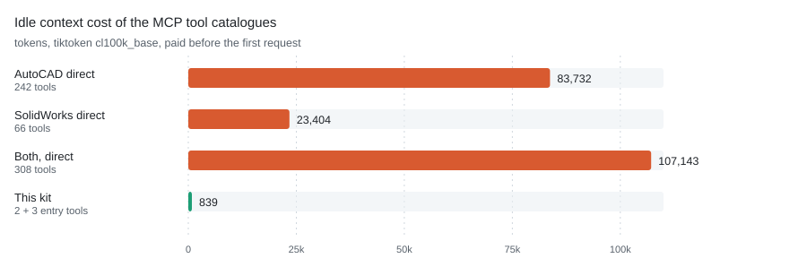

# dsh-sw-cad

[](LICENSE)
[](https://www.npmjs.com/package/dsh-sw-cad)
[](https://github.com/awesome-dsh-plugin/awesome-dsh-plugin)

[English](README.md) | 中文

> 别的 CAD MCP 把工具丢给 agent，**这个交给它一份能被验证的交付。**

一个 dsh / Codex 插件，让 agent 真的能用 **AutoCAD 和 SolidWorks**：在 ISO 图幅上画图、建模、导出 STEP，
然后**把结果读回来**，告诉你站不站得住。两个 MCP 服务器、两个技能，外加一条命令 `dsh-sw-cad deliver`
——它把「agent 说它做完了」变成一个有据可查的判定。图要交给别人核的时候，还有第二种模式：材料、配合、
表面处理必须取自取值表，而不是随便写。

```powershell
dsh-sw-cad deliver D:\work\part-001 --require drawing,pdf
# verdict: pass  (0 failure(s), 0 warning(s))  -> D:\work\part-001\delivery.json
```

## 里面有什么

| 部分 | 是什么 | 来自哪里 |
|---|---|---|
| `autocad` MCP 服务器 | 242 个工具藏在检索入口后面，COM 或无头 ezdxf | 上游 [U-C4N/Autocad-MCP](https://github.com/U-C4N/Autocad-MCP)，PyPI 安装，版本钉死 |
| `solidworks` MCP 服务器 | 66 个工具藏在检索入口后面，COM | 上游 [wzyn20051216/solidworks-automation-skill](https://github.com/wzyn20051216/solidworks-automation-skill)，安装时克隆，commit 钉死 |
| `solidworks-automation` 技能 | 66 个 Python 模块：`sw_*.py` COM 封装、OCCT/FEA/DFM、GB/T 出图子技能 | 同上 |
| `autocad-mcp-pro` 技能 | 怎么驱动 AutoCAD MCP：图层纪律、ISO 7200 标题栏、真实标注实体、交付门禁 | **本仓库写的**——上游没有 AutoCAD 技能 |
| `dsh-sw-cad` CLI | install、doctor、where、serve、**deliver**、**mode** | **本仓库写的** |
| Codex 插件壳 | `.codex-plugin/plugin.json`、`.mcp.json`、两个按需技能、只读 `SessionStart` 预检 | **本仓库写的** |
| `lib/standards.json` | 半交付模式判定用的取值表：配合、材料牌号、热处理、表面处理、Ra 数系 | **本仓库写的** |
| `patches/` | 两个上游缺陷的修复，已向上游提 PR | **本仓库写的** |

上游代码不 vendor。安装器去拉 PyPI 包、按钉死的 commit 克隆技能，所以代码归属仍在上游，你拿到的是它
当前的版本。

## 安装

四条路，选一条。

**1. 作为 Codex 插件**——从仓库自带的 marketplace 安装：

```powershell
codex plugin marketplace add 27painter/dsh-sw-cad --ref main
codex plugin add dsh-sw-cad@dsh-sw-cad
```

开一个新的 Codex 任务，并在 Codex 询问时信任 `SessionStart` hook。这个 hook 只跑只读、不阻塞的
`doctor --plugin --soft`，不安装任何东西。MCP 入口按需启动，第一次使用某一侧 CAD 时，包内的 `serve` 会安装钉死版本的上游；300 秒启动
超时就是留给这次安装的。

插件自带 manifest、MCP 声明、技能、hook 和图标。它从插件缓存目录运行
`node ./bin/dsh-sw-cad.mjs`，不要求全局安装 `dsh-sw-cad`。

Codex 插件无法在注册前探测本机装了哪个 CAD，所以两条 MCP 记录都会声明。只装一个 CAD 的机器要在
`~/.codex/config.toml` 里关掉另一侧：

```toml
[plugins."dsh-sw-cad@dsh-sw-cad".mcp_servers.autocad]
enabled = false
```

只装 AutoCAD 时，把 `autocad` 换成 `solidworks`。`codex-config.snippet.toml` 只服务非插件的
npm 全局安装；不要和插件同时添加。

**2. 作为 dsh 插件**——一条命令装完。`package.json` 声明了 `dsh.bundle.patch`，dsh 会读 `cordis.patch.yml`，
里面只插一行：本包。首次加载时插件自己解析路径、缺什么装什么，然后用绝对路径注册两个 MCP 客户端。
装不成它会抛错并指出缺的是哪一项，而不是注册两条注定起不来的记录。

```bash
dsh plugin --profile web add dsh-sw-cad
```

**3. npm 全局**——结果一样，另外把 CLI 放进 PATH：

```bash
npm install -g dsh-sw-cad
dsh-sw-cad install
dsh-sw-cad doctor
```

**4. 从仓库装**——不需要 npm，也是唯一能用到 `bootstrap.ps1 -Check` 的方式。它会检查十项，只补缺的：

```powershell
git clone https://github.com/27painter/dsh-sw-cad.git
cd dsh-sw-cad
.\bootstrap.ps1 -Check     # 只报告，不改任何东西；缺东西退出码 1
.\bootstrap.ps1            # 缺什么装什么
```

> [!WARNING]
> 第 4 条也会写 `~/.dsh/cordis.patch.yml`。如果 dsh 插件也装了，那就是同一对服务器、同一个 `serverName`
> 被注册两次，dsh 会拒绝重复，会话起不来。两条路选一条；用插件的话，让那个文件保持 `[]`。

**前提**：Windows 10/11，装了 AutoCAD 和/或 SolidWorks，Python ≥ 3.11，以及 dsh 或 Codex。Codex 插件、
dsh 插件和 npm 三条路还要 Node ≥ 20。Git 可选——git 被拦时安装器会退回 codeload zip。

两个上游项目自己的安装说明（手工装、或排查安装问题时看）原样留在
[`docs/upstream-install.md`](docs/upstream-install.md)。

**只装了一个 CAD 的机器**四条路都能用，差别只有注册方式。dsh 插件在注册前查 COM 注册表
（`lib/probe.py`，不会启动任何一个应用），只注册真正能工作的那一侧；`SW_CAD_DISABLE=autocad` 可以把
这个判断变成设置项。Codex 插件的两条记录是静态的，用上面的 `config.toml` 块关掉不用的那一侧。

**一个 CAD 都没装的机器**也不会让插件加载失败：一行日志说明「没有可驱动的应用」，一条 MCP 记录都不注册。
`deliver` 只读文件、从不启动 CAD，所以这条校验照样能用。判断顺序是先探测再安装，因此空机器上不会白装一遍上游。

### 在任意 MCP 客户端里用

不装 dsh、不装 Codex 也能用。两个都是普通的 stdio MCP 服务器，任何认 `mcpServers` 映射的客户端都能拉起它们。
用 `npm install -g dsh-sw-cad` 装过的话：

```json
{
  "mcpServers": {
    "autocad": { "command": "dsh-sw-cad", "args": ["serve", "autocad"] },
    "solidworks": { "command": "dsh-sw-cad", "args": ["serve", "solidworks"] }
  }
}
```

没全局装的话，把 `"dsh-sw-cad"` 换成 `"node"`，并把 `bin/dsh-sw-cad.mjs` 的绝对路径放到 `args` 第一位。
其余路径全由 `serve` 自己解析，缺上游时首次调用会装，所以这一整块只有那一个路径跟机器有关。

只保留你真正装了 CAD 的那一条。`dsh-sw-cad deliver` 完全不需要客户端——它是事后对文件夹跑的一条命令。

> [!IMPORTANT]
> **先开 CAD，并且同用户启动。** COM 要跨一个被 Windows 按用户和完整性级别守护的进程边界。agent 以
> 管理员身份启动、CAD 以普通身份运行（或反过来），它什么也连不上，现象看起来只是「工具什么都没干」。
>
> 这条只适用于 COM。[`dsh-nx`](https://github.com/27painter/dsh-nx) 走的是 NXOpen，跑在 NX 进程内部，
> 那边开着窗口也挂不上去，所以那个插件自己起批处理会话，**不要**预先打开 NX。习惯不要照搬。

## 怎么用

把图描述出来就行，技能会自己加载。

```text
打开 AutoCAD，画一个轴承座：底板 120×80×10，立板高 60、厚 12，上方 φ40 通孔。
ISO A3 图幅，带标题栏和尺寸，存到 D:\AutoCad 并导出 PDF。
```

```text
在 SolidWorks 里建一个法兰：外径 100，厚 20，内孔 30，四个 M10 螺栓孔均布。
存成 SLDPRT 并导出 STEP。
```

四条踩出来的经验：

- **SolidWorks 的工具参数是嵌套的。** 载荷要放在 `params` 下面：
  `call_tool(name="solidworks_sketch_and_extrude", arguments={"params": {"shape": "rectangle", ...}})`
  AutoCAD 的是平铺的。报 pydantic 缺 `params` 字段就是这条的提示。
- **一次只提一个 CAD。** 两个都提到会把两个技能都加载，任务互相干扰。
- **复杂任务先要计划。** 两个技能都有规划步骤，先批计划比画错再撤便宜得多。
- **要预览。** AutoCAD 那条路收尾是 8 步验证器加截图，SolidWorks 那条导出四视图。有个实测到的前提：
  AutoCAD 的截图需要窗口可见——隐藏或最小化会返回空白图，这不代表图画错了，几何随时可以用 API 核。

## 交付检查

这一节是上游没有的部分。

两条路的收尾不一样。AutoCAD 侧调 `drawing_finalize`——8 步验证器，**失败抛错而不是返回**，模型没法在
图纸坏掉的情况下宣称完成。SolidWorks 侧要四个预览图加一份 review report；`deliver` 不再只是读那个 report
的 `status` 字段，它要求报告里有 `checks` 明细、声称生成了预览图就必须真有图片落在旁边——否则报告只是一句
话，不是证据。`deliver` 是两边共用的收尾：它不启动任何 CAD，只读落盘的文件，撑不住就返回非零。

```powershell
dsh-sw-cad deliver D:\work\part-001 --require drawing,pdf
dsh-sw-cad deliver D:\work\part-001 --out D:\work\delivery.json --json
```

| 类型 | 真正读了什么 |
|---|---|
| `.dxf` | ezdxf：`DIMENSION` 实体、图层表、`$INSUNITS`、图纸空间有没有东西、出图幅面对 ISO 216、有没有写明比例/SCALE、线宽层级、中文文字用的字体、互相压住的尺寸文字、标题栏线索，以及**被改写的标注文字与几何实测值是否一致**（标 120、实际 118 会判失败） |
| `.dwg` | 文件头认版本；找到转换器（`DSH_SW_CAD_DWG_CONVERTER` / `dwg2dxf` / ODA）就转成 DXF，**按 DXF 全套检查**，并标一条 `dwg.converted`；找不到转换器判 `unknown`，不判 pass |
| `.pdf` | PyMuPDF：页面尺寸对 ISO 216，以及文字层是不是真的 |
| `.step` | `FILE_SCHEMA` 解析成 AP203/214/242，数实体和 `CARTESIAN_POINT`，再用原始坐标算包围盒——能抓到"零件被缩放过"和"导出里没有几何"。AP203 会告警：它丢颜色和装配结构 |
| `.sldprt` / `.sldasm` | 只看存在、大小、文件签名。**不验几何**——那需要打开软件 |
| `*_review_report.json` | `evaluation.status == pass` 与空 `issues`，**加上**：非空的 `checks` 明细、`previews_created`/`previews_not_blank`/`expected_outputs_exist` 为真、声称生成了预览图时旁边必须真有图片。只有结论没有过程的报告不算通过 |

失败时是长这样，这正是它存在的理由：

```
drawing  empty.dxf  18470 B
  FAIL drawing.dimensions     0 DIMENSION entities in modelspace
  FAIL drawing.units          $INSUNITS=0 (unitless)
  FAIL drawing.sheets         no sheet has anything on it; nothing frames the drawing
step     old.step  1779 B
  warn step.pmi               AP203 drops colour and assembly structure; use AP214 or AP242
  FAIL step.entities          40 entities, 40 CARTESIAN_POINTs
report   part_review_report.json  101 B
  FAIL review.status          evaluation.status='fail'
verdict: fail  (5 failure(s), 1 warning(s))
```

**退出码有三种，不是两种**：`0` 站得住，`1` 站不住，`2` 判不了。`2` 出现在需要读文件的能力缺失时——
没装 ezdxf 就判不了 DXF，没装 PyMuPDF 就判不了 PDF，手头没有转换器就判不了 DWG。这种情况下 verdict 是
`unknown`，**不是 pass**：一个跳过的检查不能算通过，否则调用方看到 `pass` 就真的不再看了。`delivery.json`
里 `counts.blocked` 和 `blocked[]` 写明是哪一项没跑成、为什么。

**空目录算失败**——什么都没产出的任务绝不该报成功。`delivery.json`
里每个文件带 SHA-256，所以「验的是这一版」是事实，不是靠文件名猜。

告警不改退出码，但一定带原因：AP203、原生零件没打开、整张图只有一种线宽。**缺 Python 依赖不在此列**——
它属于上面那类「判不了」，会让退出码变成 2。

**它不查、也不会假装查的**：公差配合（`H7/g6`）、材料、热处理、表面处理、尺寸链闭不闭合、零件能不能
加工。工具允许模型随便填，这里也没有标准表可以对照。`pass` 的意思是文件经得起读，**不是图纸可以下厂**。

逐项规则和 JSON 结构见 [`docs/delivery.md`](docs/delivery.md)。AutoCAD 技能里已经把它写进工作流第 6 步；
SolidWorks 技能是上游文本、本仓库不改，所以那条路要自己触发——写进任务指令，或者放进脚本最后一步。

### 两种模式

`normal`（默认）查文件本身。`half` 另外要求图纸上写的取值来自 `lib/standards.json`：配合（`H7/g6`）、
材料牌号（`45`、`40Cr`、`6061`）、优先数系里的粗糙度。表外的值判失败，没有材料也没有 `Ra` 也判失败。

```powershell
dsh-sw-cad mode half        # 设一次，之后 deliver 自动沿用
dsh-sw-cad mode             # 看当前是什么
dsh-sw-cad deliver D:\work\part-001 --profile half   # 单次覆盖
```

模式是**按任务定一次**，不是按零件。二十张图不该被打断二十次——技能只在开工前问一个问题，而且只在
提示词没说清这张图给谁用的时候问。

`delivery.json` 会写 `"profile": "half"` 和仍未检查的项。**半交付的 pass 不是全合规**，报告里写明这一点，
而不是让两者被混为一谈。

## 上下文成本

工具 schema 在第一次请求之前就要付钱。两个服务器都把目录藏在各自的 discovery 模式后面，客户端拿到的是
每个服务器两三个入口工具，而不是整本目录：

| 服务器 | 入口工具 | 常驻成本 | 后面的目录 |
|---|---:|---:|---|
| `autocad` | 2（`search_tools`、`call_tool`） | 365 token | 242 个工具，按关键词检索 |
| `solidworks` | 3（`sw_search_tools`、`sw_describe_tool`、`sw_call_tool`） | 474 token | 66 个工具（50 个 `solidworks_*`、14 个 `cadstudio_*`、2 个 `design_*`） |

<picture>
  <source media="(prefers-color-scheme: dark)" srcset="docs/token-cost-dark.svg">
  
</picture>

直连两个服务器，第一次请求前要付 107,143 token；走这个插件是 839，砍掉 99.2%。两边量法一致：抓
`tools/list` 在网线上的字节，用 `cl100k_base` 数。

```
你用自然语言说话
   │
   ├─ dsh / Codex 按 SKILL.md 的 description 懒加载技能
   │      ├─ solidworks-automation → sw_*.py → COM → SolidWorks
   │      └─ autocad-mcp-pro       → search_tools / call_tool → MCP → AutoCAD
   │
   └─ MCP 服务器（cordis.patch.yml / Codex 插件 .mcp.json）
          ├─ autocad    上游 discovery，2 个入口工具
          └─ solidworks 上游 discovery，3 个入口工具
```

## 哪些验证过，哪些没有

| CAD | 已验证 | 预期可用 | 依据 |
|---|---|---|---|
| AutoCAD | **2026**——每条 COM 路径都真机跑过；2027 API 兼容 | 2025 / 2024 / 2023 | COM 走的是长期稳定的 ActiveX API。上游带 `scripts\smoke_*_com.py` 可以自测；就算 COM 不行，ezdxf 后端完全不需要 AutoCAD。 |
| SolidWorks | **2026 SP4.1**（上游验收目标）、**2025 SP05** 真机跑过：零件→草图→矩形→拉伸→单实体→保存→STEP | 2024 / 2023 | 代码里有明确的 SW2024 修复（中文版按名选草图、`AddComponent4` 返回 `None`）。2025 那次跑出了中文草图名（`草图1`），说明那条修复路径被走到了。2023 没跑过。 |

更老的版本不会被拒绝——没有任何地方检查版本号。它们只是超出了跑过的范围，所以先用一个小任务试，看结果
再信整张图。

本包自己真跑过的：`system_status` 返回 `connected: true`、`backend: com`、运行中的版本号和活动文档；
`drawing_info` 返回实体数、范围、单位；`layer_list` 返回实时图层表；SolidWorks 侧返回 `status: ok` 并识别
到运行实例。两个 `serve` 目标都能通过本包自己的入口完成 JSON-RPC 握手——AutoCAD 自报
`AutoCAD MCP Pro 3.4.11`、2 个入口工具，SolidWorks 自报 `solidworks_mcp` 1.30.0、3 个——并且
`sw_call_tool` 用中文「健康检查」能打到运行中的 SolidWorks 2026。`dsh --dump-config` 两条记录都从本包加载。

Codex 插件壳已经从本仓库的本地 marketplace 装进隔离的 `CODEX_HOME` 实测：`codex plugin list` 和
`codex mcp list` 都把两条记录解析到插件缓存，`SessionStart` 用 `doctor --plugin` 完成，`npm run test:serve`
打开两个包内入口——AutoCAD 返回 2 个工具，SolidWorks 返回 3 个。

## 出问题的时候

| 现象 | 通常是什么 |
|---|---|
| 工具什么都不干，也不报错 | CAD 没开，或和 agent 不是同一个用户 / 完整性级别 |
| AutoCAD 工具卡住，然后提到对话框 | AutoCAD 里有弹窗——许可提示、保存提示、崩溃恢复窗 |
| 装了两条路之后 dsh 起不来 | 插件行和 `~/.dsh/cordis.patch.yml` 各注册了一次。留一个 |
| `dsh --dump-config` 里没有记录 | bundle patch 没被读到：看 `package.json` 有没有声明 `dsh.bundle.patch` |
| Codex 列不出技能 | 跑 `codex plugin list`，确认 `dsh-sw-cad` 已安装并启用，再开新任务；非插件手工安装才用 `~/.codex/skills\` 下的 junction |
| 只装一个 CAD 时 Codex 有一条 MCP 记录报错 | 在 `~/.codex/config.toml` 的 `[plugins."dsh-sw-cad@dsh-sw-cad".mcp_servers.<side>]` 下关掉缺的那一侧 |
| 第一次用 CAD 超时 | 上游可能还在安装。先跑 `doctor`，再重试；MCP 启动最多等 300 秒 |
| Codex 的 `SessionStart` hook 没跑 | 插件 hook 需要显式信任。在 Codex 里查看并信任，然后开新任务 |
| AutoCAD 截图是空白 | 窗口被隐藏或最小化了。几何仍然可以用 API 核 |
| `sw_call_tool` 说工具名不认识 | 它只认目录里的名字，先跑 `sw_search_tools` |
| `sw_search_tools` 搜不出东西 | 服务器在 `full` 模式，没有检索入口——检查 `SW_MCP_DISCOVERY` |
| 某个尺寸量出来是 0.0，或边长是 null | 上游补丁没打上：`python patches\apply_patches.py --check` |
| `deliver` 判你一张自认为没问题的图失败 | 看失败项的 id，每一项都写了它找什么、找到什么 |

## 验证安装

```powershell
dsh-sw-cad doctor                              # 只读，缺东西退出码 1
dsh-sw-cad where                               # 服务器会用到的每个路径
dsh --profile headless --dump-config           # dsh 看见两条记录
python patches\apply_patches.py --check        # 只读，补丁漂了退出码 1
npm run test:serve                             # JSON-RPC 握手，应为 2 + 3 个入口工具
npm test                                       # dsh 注册、Codex manifest、6 个交付检查用例
codex plugin list                              # Codex 看见 dsh-sw-cad@dsh-sw-cad
codex mcp list                                 # autocad 和 solidworks 两条记录
codex mcp get autocad                          # 解析后的命令、cwd、超时
codex mcp get solidworks
```

## 来源

| 部分 | 来源 | 许可证 |
|---|---|---|
| AutoCAD MCP 服务器 | [U-C4N/Autocad-MCP](https://github.com/U-C4N/Autocad-MCP)，PyPI 装，钉在 1.6.0 | MIT |
| SolidWorks 技能 + MCP 服务器 | [wzyn20051216/solidworks-automation-skill](https://github.com/wzyn20051216/solidworks-automation-skill)，按钉死的 commit 克隆 | MIT |
| AutoCAD 技能、CLI、安装器、`deliver`、`patches/`、本 README | 本仓库 | MIT |

**"不碰上游"有一个刻意的例外**：`patches/` 装着两个上游缺陷的修复，它们都不报错——竖向线性标注量出来是
0.0，每条边的直径和长度都返回 null。两个都已向上游提 PR；在合并之前，`install.ps1` 会把补丁打到已安装的
副本上，`apply_patches.py --check` 报告是否漂移。详见 [`patches/README.md`](patches/README.md) 与
[`THIRD-PARTY-NOTICES.md`](THIRD-PARTY-NOTICES.md)。

## 许可证

MIT，Copyright (c) 2026 27painter —— 见 [LICENSE](LICENSE)。上游组件保留各自的 MIT 许可证，本仓库不
重新分发它们。

已收录于 [M8ven Trust Index](https://m8ven.ai/mcp/27painter-dsh-sw-cad-72nbze) 与
[awesome-dsh-plugin](https://github.com/awesome-dsh-plugin/awesome-dsh-plugin)。

[](https://m8ven.ai/mcp/27painter-dsh-sw-cad-72nbze?s=readme)
